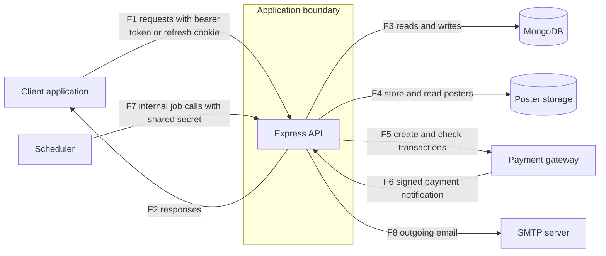

# Threat Model: PassGo backend

Status: draft, part 3 of 3 (adds the test plan). No results are recorded here. This file contains no findings.

Target: gadicandra/PassGo, branch staging, commit e2bfb20 (backend only).

## Ringkasan (Bahasa Indonesia)
- Model ancaman untuk backend PassGo (penjualan tiket acara komunitas) pada commit yang dikunci.
- Bagian 1 memuat deskripsi sistem, aset, aktor, diagram aliran data, dan batas kepercayaan. Bagian 2 memuat analisis STRIDE per batas kepercayaan. Bagian 3 memuat rencana uji dengan ID kasus uji; semuanya berstatus Not run. Belum ada hasil uji di dokumen ini.
- Disusun dari pembacaan kode oleh LLM yang belum diverifikasi mandiri oleh penulis, bukan dari menjalankan aplikasi. Hal yang bergantung pada deployment ditulis "tidak ditentukan".
- Dokumen ini tidak memuat temuan atau detail kerentanan.

## Method
Built from a reading of the application code at the pinned commit, performed by an LLM from curated code bundles and not yet independently verified by the author (LLM output is treated as a hypothesis): entry points, configuration, routes, middleware, services and data models, as far as the bundles covered them. Nothing was run. Deployment details (network, TLS, hosting, scheduling, cloud configuration) were not examined and are marked as undetermined.

## System description
A REST API for selling tickets to community events. Organizers create and publish events and ticket types, assign staff to events, and manage user accounts. Attendees register, log in, browse a public event catalog, place orders and receive tickets by email. Orders can be paid through an external payment gateway, which reports payment status back to the API by a signed notification. Staff check tickets in at the event. Organizers can export attendee data and reports, and an audit log records selected actions. Background jobs (sending queued emails, expiring unpaid orders) are started by an external scheduler calling an internal route.

Technology: Node.js, Express 5, TypeScript, MongoDB with Mongoose, JWT access tokens with rotating refresh tokens in a cookie, bcrypt password hashes, zod input validation, an object storage service for event posters (local disk when no storage credentials are configured), an external payment gateway (Midtrans), and SMTP email through an outbox.

## Assets
| Asset | Why it matters |
|---|---|
| User accounts (email, name, phone, password hash, role) | Personal data and the basis of authentication and authorization |
| Access tokens, refresh tokens, one-time auth tokens, and the token signing key | Anyone holding a valid token acts as that user |
| Roles and event staff assignments | Decide who may manage events, check in tickets and see attendee data |
| Events, ticket types and ticket stock | Business data; stock is limited and contended |
| Orders, payments, refunds | Financial records between buyers and organizers; integrity matters |
| Tickets, ticket codes and check-in records | A ticket code is the proof of entry; check-in must happen once |
| Attendee exports and reports | Contain buyer personal data in bulk |
| Poster images | Public-facing content uploaded by users |
| Email outbox and email content | May contain one-time links and ticket codes |
| Audit log | Basis for accountability |
| Service credentials (database, storage, payment gateway, SMTP, scheduler secret) | Grant access to data stores, money flows and internal jobs |
| Service availability | Ticket sales and entry on the day of an event depend on it |

## Actors
| Actor | Description |
|---|---|
| Anonymous visitor | No account; can browse the public event catalog, register, log in, request a password reset, and reach the health check |
| Attendee | Authenticated buyer; can create orders and read own orders and tickets |
| Staff | Authenticated user assigned to specific events; can check in tickets for those events |
| Organizer | Authenticated user with the highest application role; manages events, users, staff assignments, exports and reports |
| Malicious authenticated user | Any account holder who abuses the access the role legitimately gives |
| Payment gateway | External service that creates transactions and sends payment notifications |
| Scheduler | External caller that starts internal jobs with a shared secret |
| External services | Database, poster storage, SMTP server; trusted to behave but outside the application |
| Operator / developer | Deploys the service and holds its configuration |

## Data flow diagram

| Flow | From | To | Content |
|---|---|---|---|
| F1 | Client | API | Registration, login, token refresh, event, order, ticket, user and export requests; bearer access token on protected routes; refresh token in a cookie |
| F2 | API | Client | JSON responses, files for exports, cookies |
| F3 | API | Database | Reads and writes of all collections, including multi-document transactions |
| F4 | API | Poster storage | Poster image written on upload and referenced for display |
| F5 | API | Payment gateway | Transaction creation and status checks for paid orders |
| F6 | Payment gateway | API | Payment status notification, authenticated by a signature |
| F7 | Scheduler | API | Calls to the internal job route, authenticated by a shared secret |
| F8 | API | SMTP server | Emails built from the outbox, including one-time links and ticket details |

## Trust boundaries
| ID | Boundary | What crosses it |
|---|---|---|
| TB1 | Client to API | All user input, access tokens, refresh cookies; untrusted until validated and authenticated |
| TB2 | API to database | Queries and transactions; the database is trusted to hold data correctly |
| TB3 | API to poster storage | User-supplied image files |
| TB4 | API and payment gateway (both directions) | Outbound transaction requests; inbound notifications that arrive from the internet and claim to come from the gateway |
| TB5 | Inside the authenticated zone: roles and event assignments | Authenticated users are not automatically allowed to act on a given event, order or account; the application must enforce role and assignment per request |
| TB6 | Scheduler to internal jobs | Requests that start maintenance jobs; must be accepted only from the scheduler |
| TB7 | API to SMTP server | Email content, including one-time links and ticket details, leaves the system |

## Undetermined (not examined)
- Transport security between client and API, and between API and each service.
- Hosting, network exposure, proxy configuration, scheduling configuration, cloud configuration and secrets management of any deployed instance (out of scope, never contacted).
- The account seeding script and the values it uses to create first accounts.
- The configuration of the payment gateway account and of the poster storage service.
- The client application.

## Assumptions (from code reading, not independently verified)

These are read from the pinned commit's source by an LLM and are treated as hypotheses
until confirmed with the repository owners (see Methodology above).

- Organizer authorization is flat across events: the `authorize("ORGANIZER")` role check
  does not verify event ownership anywhere in the codebase examined. The `createdBy`
  field recorded at event creation is stored but never used for authorization. In
  practice, any ORGANIZER account can view, modify, publish, cancel, or manage the
  staff and ticket types of any event, not only events it created. STAFF accounts are
  restricted to assigned, non-DRAFT events via a separate check.
- Whether this is an intentional single-tenant assumption or an oversight has not been
  confirmed with the repository owners. Pending confirmation.
## STRIDE by trust boundary

These are categories of threat to test, not findings. Each row says in general terms what could go wrong and which kind of test in the manual testing phase will check it, on a local test instance only. Nothing here states that a weakness exists.

Categories: S spoofing, T tampering, R repudiation, I information disclosure, D denial of service, E elevation of privilege.

### TB1 Client to API
| Cat | Threat | Planned test |
|---|---|---|
| S | Forged, tampered, expired or replayed access tokens; refresh tokens used after logout, password reset, deactivation or rotation, or used twice at the same time; guessing of login credentials; registration with an email address the registrant does not own | Token handling tests (tampered, expired, missing claims, unexpected algorithm); refresh token lifecycle tests (rotation, reuse, parallel use, each revocation path); repeated login attempts against the local instance |
| T | Crafted bodies, query parameters and headers (wrong types, extreme values, extra fields, identifiers of other objects, repeated request keys); requests from other origins that carry the refresh cookie | Input validation and boundary tests per route; idempotency and conditional update tests; origin allowlist tests on cookie-authenticated routes |
| R | Account and role changes without a trace of who made them | Review of what the audit log and other records cover (reading only) |
| I | Responses, response times or error messages that reveal whether accounts or objects exist, or data of other users | Compare responses and response times (many samples) for existing and non-existing objects; error response review |
| D | One client repeating costly operations (password hashing, searches with user-supplied patterns, exports, bulk operations, uploads, routes that send email) | Bounded load tests against the local instance only; review of which routes limit request rates |
| E | Reaching routes reserved for a higher role | Access matrix: every route against anonymous, attendee, staff (assigned and unassigned event) and organizer |

### TB2 API to database
| Cat | Threat | Planned test |
|---|---|---|
| T | User input reaching queries as operators or patterns (injection) | Injection tests on every input that reaches a query, including search parameters |
| T | Updates that skip schema validation, and lost updates under concurrent requests | Update path validation tests; parallel request tests on the same object |
| I | Over-broad data returned from queries, such as credential or token fields | Response field review per route |
| D | Expensive queries, unbounded lists and large result sets | Large-data tests on the local database |
| E | Application database login with more privileges than needed | Privilege review of the local test login (any deployed instance is not examined) |

### TB3 API to poster storage
| Cat | Threat | Planned test |
|---|---|---|
| T | Files that are not images, crafted or malformed images, oversized files, unexpected names or content types | File type, size, malformed image and name tests in the local disk mode (no storage credentials) |
| T | A poster attached to or replaced on an event the user does not manage | Ownership tests on poster routes |
| I | Stored files reachable by someone who should not see them | Object access tests through the API and the local static route |
| D | Many, large or very high resolution uploads | Bounded upload tests on the local instance |

### TB4 API and payment gateway
| Cat | Threat | Planned test |
|---|---|---|
| S | Forged, replayed or mismatched payment notifications (wrong signature, wrong amount, unknown order, late arrival) | Notification tests with signatures computed locally from a made-up key; no traffic to the real service |
| T | Client-influenced prices, quantities or totals; free orders | Price, quantity and boundary tests on order creation |
| R | Payments and refunds without a trace | Review of audit coverage for payments and refunds (reading only) |
| I | Gateway responses or tokens stored or returned beyond need | Review of responses and stored records in the local database |
| D | Gateway failures or retries leaving inconsistent state; many pending orders holding stock | Failure injection with a local mock of the gateway module; stock holding tests |

### TB5 Roles and event assignments
| Cat | Threat | Planned test |
|---|---|---|
| E | Staff acting on events they are not assigned to; users reading or changing other users' orders and tickets; lower roles reaching organizer actions | Access matrix and object-level tests with own and other users' identifiers |
| E | Role or status changes while an access token is still valid | Token behavior tests after role change, deactivation and password reset |
| T | State changes with side effects (check-in reversal, event cancellation, role change, staff assignment) done out of order or twice | State transition and repeat-request tests |
| R | Staff assignment, role change and account management not recorded | Review of audit coverage (reading only) |
| I | Staff or buyers seeing more personal data than they need (attendee lists, search by email) | Response field review per role |
| D | Bulk operations by privileged users (exports, reports, cancellation) on large data | Bounded tests with large local data |

### TB6 Scheduler to internal jobs
| Cat | Threat | Planned test |
|---|---|---|
| S | Calls to the internal route with no secret, a wrong secret, an empty configured secret, unexpected job names or other HTTP methods | Authentication tests of the internal route for each case, on the local instance |
| T | Jobs run twice or at the same time (duplicate emails, expiry racing with payment) | Repeat and parallel job run tests |
| I | Error responses that reveal internal state | Response review of the internal route |
| D | Jobs triggered repeatedly | Bounded repeat tests on the local instance |

### TB7 API to SMTP server
| Cat | Threat | Planned test |
|---|---|---|
| S | Reset or verification emails triggered for addresses the requester does not own | Response uniformity and email count tests with the dry-run mode or a local mail catcher |
| T | Header or content injection through user-supplied fields (names, event titles) in emails | Injection tests on fields that reach email content |
| I | One-time links and ticket details kept or logged longer than needed (outbox records, logs) | Review of outbox records and logs in the local instance (values never published) |
| D | Routes that cause many emails to one recipient or many recipients | Email count tests per user action in dry-run mode |

### Cross-cutting
| Area | Planned test |
|---|---|
| Dependencies and install scripts | Dependency scan; install with lifecycle scripts disabled |
| Secrets and configuration in the repository and documentation | Secret scan of the pinned commit (values never printed); review of how completely configuration is documented |
| Error logging and error messages | Review of what is logged and returned on errors, in production and non-production mode (reading only) |
| Behind a proxy | Review of how client address and protocol are determined |
| The repository's own tests | Reading the tests before running anything, because some may expect external services |

## Test plan

Order is the sequence in which tests are planned, not a severity. P1 means the test covers data or money of other users, access control, or is cheap and automated. P2 covers integrity of derived state, cost and availability. P3 is review or hardening. The order is a planning judgement and will be revisited after the baseline scans. All tests run on the local test environment only. Results stay private until a fix is confirmed.

| ID | Boundary and category | Test | Order | Result |
|---|---|---|---|---|
| PG-T01 | TB1 S | Token handling, refresh token lifecycle and login behavior | P1 | Not run |
| PG-T02 | TB1 T | Input validation, boundary, idempotency and cross-origin tests per route | P2 | Not run |
| PG-T03 | TB1 R | Review of what the audit log and other records cover | P3 | Not run |
| PG-T04 | TB1 I | Response and response-time comparison (many samples) for existing and non-existing objects; error response review | P2 | Not run |
| PG-T05 | TB1 D | Bounded load tests of costly operations; review of which routes limit request rates | P2 | Not run |
| PG-T06 | TB1 E | Access matrix across all routes and actor types | P1 | Not run |
| PG-T07 | TB2 T | Injection tests on inputs that reach queries, including search parameters | P1 | Not run |
| PG-T08 | TB2 T | Update path validation and parallel request tests | P2 | Not run |
| PG-T09 | TB2 I | Response field review per route | P1 | Not run |
| PG-T10 | TB2 D | Large-data tests | P3 | Not run |
| PG-T11 | TB2 E | Privilege review of the local test login | P3 | Not run |
| PG-T12 | TB3 T | File type, size, malformed image and name tests in the local disk mode | P2 | Not run |
| PG-T13 | TB3 T | Ownership tests on poster routes | P2 | Not run |
| PG-T14 | TB3 I | Object access tests through the API and the local static route | P2 | Not run |
| PG-T15 | TB3 D | Bounded upload tests | P3 | Not run |
| PG-T16 | TB4 S | Payment notification tests with signatures computed locally from a made-up key | P1 | Not run |
| PG-T17 | TB4 T | Price, quantity and boundary tests on order creation | P1 | Not run |
| PG-T18 | TB4 R | Review of audit coverage for payments and refunds | P3 | Not run |
| PG-T19 | TB4 I | Review of responses and stored records | P2 | Not run |
| PG-T20 | TB4 D | Failure injection with a local mock of the gateway module; stock holding tests | P2 | Not run |
| PG-T21 | TB5 E | Access matrix and object-level tests with own and other users' identifiers | P1 | Not run |
| PG-T22 | TB5 E | Token behavior tests after role change, deactivation and password reset | P1 | Not run |
| PG-T23 | TB5 T | State transition and repeat-request tests | P2 | Not run |
| PG-T24 | TB5 R | Review of audit coverage for staff assignment, role change and account management | P3 | Not run |
| PG-T25 | TB5 I | Response field review per role | P1 | Not run |
| PG-T26 | TB5 D | Bounded tests with large local data | P3 | Not run |
| PG-T27 | TB6 S | Authentication tests of the internal route | P1 | Not run |
| PG-T28 | TB6 T | Repeat and parallel job run tests | P2 | Not run |
| PG-T29 | TB6 I | Response review of the internal route | P3 | Not run |
| PG-T30 | TB6 D | Bounded repeat tests | P3 | Not run |
| PG-T31 | TB7 S | Response uniformity and email count tests | P2 | Not run |
| PG-T32 | TB7 T | Injection tests on fields that reach email content | P2 | Not run |
| PG-T33 | TB7 I | Review of outbox records and logs | P2 | Not run |
| PG-T34 | TB7 D | Email count tests per user action | P2 | Not run |
| PG-T35 | Cross-cutting | Dependency scan; install with lifecycle scripts disabled | P1 | Not run |
| PG-T36 | Cross-cutting | Secret scan of the pinned commit, values never printed; review of how completely configuration is documented | P1 | Not run |
| PG-T37 | Cross-cutting | Review of what is logged and returned on errors | P3 | Not run |
| PG-T38 | Cross-cutting | Review of how client address and protocol are determined behind a proxy | P3 | Not run |
| PG-T39 | Cross-cutting | Reading the repository's own tests before running anything | P1 | Not run |

## Next
Read the repository's own tests (PG-T39), build and verify the test environment, run the baseline scans (PG-T35, PG-T36), then execute the tests in order. A result is recorded as a finding only after manual verification, and published only in sanitized form after the owner confirms the fix.
