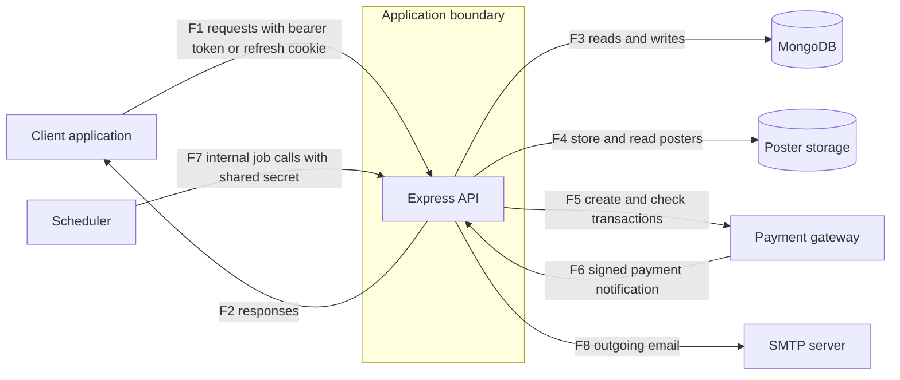

# Threat Model: PassGo backend

Status: draft, part 1 of 3 (system, assets, actors, data flow, trust boundaries). No results are recorded here. This file contains no findings.

Target: gadicandra/PassGo, branch staging, commit e2bfb20 (backend only).

## Ringkasan (Bahasa Indonesia)
- Model ancaman untuk backend PassGo (penjualan tiket acara komunitas) pada commit yang dikunci.
- Bagian 1 memuat deskripsi sistem, aset, aktor, diagram aliran data, dan batas kepercayaan. Bagian 2 (analisis STRIDE per batas kepercayaan) dan bagian 3 (rencana uji dengan ID kasus uji) akan menyusul. Belum ada hasil uji di dokumen ini.
- Disusun dari pembacaan kode oleh LLM yang belum diverifikasi mandiri oleh penulis, bukan dari menjalankan aplikasi. Hal yang bergantung pada deployment ditulis "tidak ditentukan".
- Dokumen ini tidak memuat temuan atau detail kerentanan.

## Method
Built from a reading of the application code at the pinned commit, performed by an LLM from curated code bundles and not yet independently verified by the author (LLM output is treated as a hypothesis): entry points, configuration, routes, middleware, services and data models, as far as the bundles covered them. Nothing was run. Deployment details (network, TLS, hosting, scheduling, cloud configuration) were not examined and are marked as undetermined.

## System description
A REST API for selling tickets to community events. Organizers create and publish events and ticket types, assign staff to events, and manage user accounts. Attendees register, log in, browse a public event catalog, place orders and receive tickets by email. Orders can be paid through an external payment gateway, which reports payment status back to the API by a signed notification. Staff check tickets in at the event. Organizers can export attendee data and reports, and an audit log records selected actions. Background jobs (sending queued emails, expiring unpaid orders) are started by an external scheduler calling an internal route.

Technology: Node.js, Express 5, TypeScript, MongoDB with Mongoose, JWT access tokens with rotating refresh tokens in a cookie, bcrypt password hashes, zod input validation, an object storage service for event posters (local disk when no storage credentials are configured), an external payment gateway (Midtrans), and SMTP email through an outbox.

## Assets
| Asset | Why it matters |
|---|---|
| User accounts (email, name, phone, password hash, role) | Personal data and the basis of authentication and authorization |
| Access tokens, refresh tokens, one-time auth tokens, and the token signing key | Anyone holding a valid token acts as that user |
| Roles and event staff assignments | Decide who may manage events, check in tickets and see attendee data |
| Events, ticket types and ticket stock | Business data; stock is limited and contended |
| Orders, payments, refunds | Financial records between buyers and organizers; integrity matters |
| Tickets, ticket codes and check-in records | A ticket code is the proof of entry; check-in must happen once |
| Attendee exports and reports | Contain buyer personal data in bulk |
| Poster images | Public-facing content uploaded by users |
| Email outbox and email content | May contain one-time links and ticket codes |
| Audit log | Basis for accountability |
| Service credentials (database, storage, payment gateway, SMTP, scheduler secret) | Grant access to data stores, money flows and internal jobs |
| Service availability | Ticket sales and entry on the day of an event depend on it |

## Actors
| Actor | Description |
|---|---|
| Anonymous visitor | No account; can browse the public event catalog, register, log in, request a password reset, and reach the health check |
| Attendee | Authenticated buyer; can create orders and read own orders and tickets |
| Staff | Authenticated user assigned to specific events; can check in tickets for those events |
| Organizer | Authenticated user with the highest application role; manages events, users, staff assignments, exports and reports |
| Malicious authenticated user | Any account holder who abuses the access the role legitimately gives |
| Payment gateway | External service that creates transactions and sends payment notifications |
| Scheduler | External caller that starts internal jobs with a shared secret |
| External services | Database, poster storage, SMTP server; trusted to behave but outside the application |
| Operator / developer | Deploys the service and holds its configuration |

## Data flow diagram

| Flow | From | To | Content |
|---|---|---|---|
| F1 | Client | API | Registration, login, token refresh, event, order, ticket, user and export requests; bearer access token on protected routes; refresh token in a cookie |
| F2 | API | Client | JSON responses, files for exports, cookies |
| F3 | API | Database | Reads and writes of all collections, including multi-document transactions |
| F4 | API | Poster storage | Poster image written on upload and referenced for display |
| F5 | API | Payment gateway | Transaction creation and status checks for paid orders |
| F6 | Payment gateway | API | Payment status notification, authenticated by a signature |
| F7 | Scheduler | API | Calls to the internal job route, authenticated by a shared secret |
| F8 | API | SMTP server | Emails built from the outbox, including one-time links and ticket details |

## Trust boundaries
| ID | Boundary | What crosses it |
|---|---|---|
| TB1 | Client to API | All user input, access tokens, refresh cookies; untrusted until validated and authenticated |
| TB2 | API to database | Queries and transactions; the database is trusted to hold data correctly |
| TB3 | API to poster storage | User-supplied image files |
| TB4 | API and payment gateway (both directions) | Outbound transaction requests; inbound notifications that arrive from the internet and claim to come from the gateway |
| TB5 | Inside the authenticated zone: roles and event assignments | Authenticated users are not automatically allowed to act on a given event, order or account; the application must enforce role and assignment per request |
| TB6 | Scheduler to internal jobs | Requests that start maintenance jobs; must be accepted only from the scheduler |
| TB7 | API to SMTP server | Email content, including one-time links and ticket details, leaves the system |

## Undetermined (not examined)
- Transport security between client and API, and between API and each service.
- Hosting, network exposure, proxy configuration, scheduling configuration, cloud configuration and secrets management of any deployed instance (out of scope, never contacted).
- The account seeding script and the values it uses to create first accounts.
- The configuration of the payment gateway account and of the poster storage service.
- The client application.

## Next
Part 2 will add STRIDE by trust boundary. Part 3 will add a test plan with case IDs. Results are recorded only after local testing and owner confirmation of fixes, in sanitized form.
