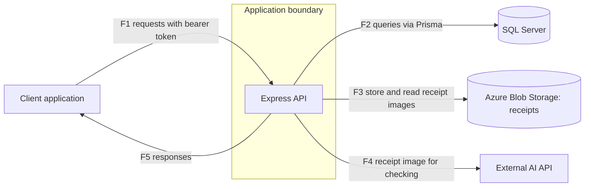

# Threat Model: PatunganKu backend

Status: draft, part 3 of 3 (adds test plan with case IDs). No results are recorded here. This file contains no findings.

Target: ReyMindThink/PatunganKu, branch main, commit 0d7098b (backend only).

## Ringkasan (Bahasa Indonesia)
- Model ancaman untuk backend PatunganKu (aplikasi patungan biaya) pada commit yang dikunci.
- Bagian 1 memuat deskripsi sistem, aset, aktor, diagram aliran data, dan batas kepercayaan. Bagian 2 memuat analisis STRIDE per batas kepercayaan. Bagian 3 memuat rencana uji dengan ID kasus uji. Belum ada hasil uji di dokumen ini.
- Disusun dari pembacaan kode oleh LLM yang belum diverifikasi mandiri oleh penulis, bukan dari menjalankan aplikasi. Hal yang bergantung pada deployment ditulis "tidak ditentukan".
- Dokumen ini tidak memuat temuan atau detail kerentanan.

## Method
Built from a reading of the application code at the pinned commit, performed by an LLM from curated code bundles and not yet independently verified by the author (LLM output is treated as a hypothesis): entry
points, configuration, routes, middleware, libraries, services, utilities,
validators and the database schema. Nothing was run. Deployment details (network,
TLS, hosting, cloud configuration) were not examined and are marked as
undetermined.

## System description
A REST API for splitting shared expenses inside groups. Users register and log in,
create or join groups with a short code, record shared expenses with equal or
custom splits, view balances and suggested settlements, record payments between
members, and attach a receipt photo to an expense. A receipt can be checked by an
external AI service, which reads the total and judges whether the image is a
receipt.

Technology: Node.js, Express 5, Prisma with SQL Server, Azure Blob Storage for
receipt images, an external AI API for receipt checking, JWT bearer tokens,
bcrypt password hashes, zod input validation.

## Assets
| Asset | Why it matters |
|---|---|
| User accounts (email, name, phone, password hash) | Personal data and the basis of authentication |
| Authentication tokens and the token signing key | Anyone holding a valid token acts as that user |
| Groups, membership, group join code | The group is the access boundary for financial data |
| Expenses, splits, payment confirmations | Financial records between real people; integrity matters |
| Receipt images | May contain personal or purchase details |
| Service credentials (database, blob storage, AI API) | Grant access to data stores and paid services |
| AI API quota and cost | Metered external service |
| Service availability | Group members depend on correct balances |

## Actors
| Actor | Description |
|---|---|
| Anonymous visitor | No account; can reach registration, login and health check |
| Authenticated non-member | Has an account but is not in the group in question |
| Group member | Has joined the group; can read and record data in it |
| Group owner | Member with an OWNER role label in the data model |
| Malicious member | A member who abuses the access they legitimately have |
| External services | Database, blob storage, AI API; trusted to behave but outside the application |
| Operator / developer | Deploys the service and holds its configuration |

## Data flow diagram

| Flow | From | To | Content |
|---|---|---|---|
| F1 | Client | API | Registration, login, group, expense, payment and receipt upload requests; bearer token on protected routes |
| F2 | API | Database | Reads and writes of users, groups, expenses, splits, payments |
| F3 | API | Blob storage | Receipt image written on upload and read for checking |
| F4 | API | AI API | Receipt image sent for checking; structured result returned |
| F5 | API | Client | JSON responses |

## Trust boundaries
| ID | Boundary | What crosses it |
|---|---|---|
| TB1 | Client to API | All user input; untrusted until validated and authenticated |
| TB2 | API to database | Queries; the database is trusted to hold data correctly |
| TB3 | API to blob storage | User-supplied image files |
| TB4 | API to AI API | User-supplied image leaves the system to a third party |
| TB5 | Inside the authenticated zone: group membership | Authenticated users are not automatically allowed to see or change a given group's data; the application must enforce membership per request |

## Undetermined (not examined)
- Transport security between client and API, and between API and each service.
- Hosting, network exposure, cloud configuration and secrets management of any deployed instance (out of scope, never contacted).
- The client application.

## STRIDE by trust boundary

These are categories of threat to test, not findings. Each row says in general terms what could go wrong and which kind of test in the manual testing phase will check it, on a local test instance only. Nothing here states that a weakness exists.

Categories: S spoofing, T tampering, R repudiation, I information disclosure, D denial of service, E elevation of privilege.

### TB1 Client to API
| Cat | Threat | Planned test |
|---|---|---|
| S | Forged, tampered, expired or replayed bearer tokens; guessing of login credentials; registration with an email address the registrant does not own | Token handling tests (tampered, expired, missing claims, unexpected algorithm); repeated login attempts against the local instance |
| T | Crafted bodies and URL parameters (wrong types, extreme values, extra fields, identifiers of other objects) | Input validation and boundary tests per endpoint |
| R | Changes to financial records without a trace of who made them | Review of what the application records about actions (reading only) |
| I | Responses or error messages that reveal whether accounts or objects exist, or data of other groups | Compare responses for existing and non-existing objects; error response review |
| D | One client repeating costly operations (password hashing, uploads, external calls) | Bounded load test against the local instance only |
| E | Acting in a group without membership, or doing what is reserved for another member | Access matrix: every endpoint against anonymous, non-member, member and the other party of a payment |

### TB2 API to database
| Cat | Threat | Planned test |
|---|---|---|
| T | Input reaching queries (injection) | Injection tests on every input that reaches a query |
| I | Over-broad data returned from queries | Response field review per endpoint |
| D | Expensive queries or unbounded result sets | Large-data tests on the local database |
| E | Application database login with more privileges than needed | Privilege review of the local test login (any deployed instance is not examined) |

### TB3 API to blob storage
| Cat | Threat | Planned test |
|---|---|---|
| T | Files that are not images, crafted files, oversized files | File type, size and malformed file tests with the local storage emulator |
| T | A stored file replaced after it was accepted | State transition tests on receipt status |
| I | Stored images reachable by someone who should not see them | Object access tests through the API |
| D | Many or large uploads | Bounded upload tests on the local instance |

### TB4 API to AI API
| Cat | Threat | Planned test |
|---|---|---|
| S | A fake receipt accepted as genuine | Decision-logic tests with mocked results around each threshold |
| T | Image content crafted to influence the AI result | Decision-logic tests with a local mock of the AI response; no traffic to the real service |
| I | Personal data inside images leaves the system | Data flow review: what is sent, and whether users are told (documentation review) |
| D | Repeated calls consuming a metered quota | Count external calls per user action using the local mock |

### TB5 Group membership
| Cat | Threat | Planned test |
|---|---|---|
| S | Joining a group by guessing or sharing the join code | Join behavior tests on the local instance |
| T | A member recording expenses or payments that affect other members | State and ownership tests on expense and payment creation |
| I | A new member seeing history and personal details of other members | Response field review for group detail and history |
| E | Role labels versus the permissions that are actually enforced | Role matrix tests for every action |

### Cross-cutting
| Area | Planned test |
|---|---|
| Dependencies and install scripts | Dependency scan; install with lifecycle scripts disabled |
| Secrets and configuration in the repository and documentation | Secret scan of the pinned commit (values never printed) |
| Error logging | Review of what is logged on errors (reading only) |

## Test plan

Order is the sequence in which tests are planned, not a severity. P1 means the test covers data or money of other users, or is cheap and automated. P2 covers integrity of derived state, cost and availability. P3 is review or hardening. The order is a planning judgement and will be revisited after the baseline scans. All tests run on the local test environment only. Results stay private until a fix is confirmed.

| ID | Boundary and category | Test | Order | Result |
|---|---|---|---|---|
| PK-T01 | TB1 S | Token handling and login behavior | P1 | Not run |
| PK-T02 | TB1 T | Input validation and boundary tests per endpoint | P2 | Not run |
| PK-T03 | TB1 R | Review of what the application records about actions | P3 | Not run |
| PK-T04 | TB1 I | Response comparison for existing and non-existing objects; error response review | P2 | Not run |
| PK-T05 | TB1 D | Bounded load test of costly operations | P2 | Not run |
| PK-T06 | TB1 E | Access matrix across all endpoints and actor types | P1 | Not run |
| PK-T07 | TB2 T | Injection tests on inputs that reach queries | P1 | Not run |
| PK-T08 | TB2 I | Response field review per endpoint | P1 | Not run |
| PK-T09 | TB2 D | Large-data tests | P3 | Not run |
| PK-T10 | TB2 E | Privilege review of the local test login | P3 | Not run |
| PK-T11 | TB3 T | File type, size and malformed file tests | P2 | Not run |
| PK-T12 | TB3 T | State transition tests on receipt status | P2 | Not run |
| PK-T13 | TB3 I | Object access tests through the API | P1 | Not run |
| PK-T14 | TB3 D | Bounded upload tests | P3 | Not run |
| PK-T15 | TB4 S | Decision-logic tests with mocked results around each threshold | P2 | Not run |
| PK-T16 | TB4 T | Decision-logic tests with a local mock and crafted content | P3 | Not run |
| PK-T17 | TB4 I | Data flow review of what is sent and whether users are told | P2 | Not run |
| PK-T18 | TB4 D | Count external calls per user action using the local mock | P2 | Not run |
| PK-T19 | TB5 S | Join behavior tests | P2 | Not run |
| PK-T20 | TB5 T | State and ownership tests on expense and payment creation | P1 | Not run |
| PK-T21 | TB5 I | Response field review for group detail and history | P1 | Not run |
| PK-T22 | TB5 E | Role matrix tests for every action | P1 | Not run |
| PK-T23 | Cross-cutting | Dependency scan; install with lifecycle scripts disabled | P1 | Not run |
| PK-T24 | Cross-cutting | Secret scan of the pinned commit, values never printed | P1 | Not run |
| PK-T25 | Cross-cutting | Review of what is logged on errors | P3 | Not run |

## Next
Build and verify the test environment, run the baseline scans (PK-T23, PK-T24), then execute the tests in order. A result is recorded as a finding only after manual verification.