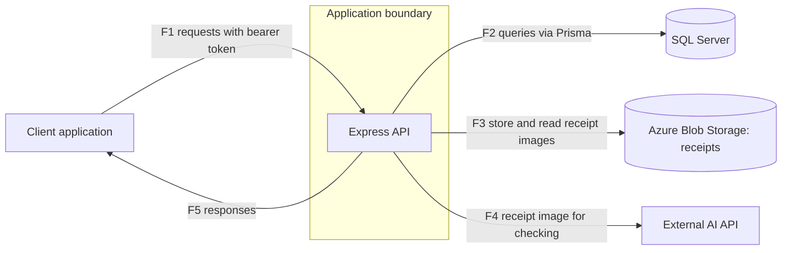

# Threat Model: PatunganKu backend

Status: draft, part 1 of 2 (system, assets, actors, data flows, trust boundaries). STRIDE analysis and risk ranking follow in part 2. This file contains no findings.

Target: ReyMindThink/PatunganKu, branch main, commit 0d7098b (backend only).

## Ringkasan (Bahasa Indonesia)
- Model ancaman untuk backend PatunganKu (aplikasi patungan biaya) pada commit yang dikunci.
- Bagian 1 memuat deskripsi sistem, aset, aktor, diagram aliran data, dan batas kepercayaan. Analisis STRIDE dan prioritas risiko ada di bagian 2.
- Disusun dari pembacaan kode oleh LLM yang belum diverifikasi mandiri oleh penulis, bukan dari menjalankan aplikasi. Hal yang bergantung pada deployment ditulis "tidak ditentukan".
- Dokumen ini tidak memuat temuan atau detail kerentanan.

## Method
Built from a reading of the application code at the pinned commit, performed by an LLM from curated code bundles and not yet independently verified by the author (LLM output is treated as a hypothesis): entry
points, configuration, routes, middleware, libraries, services, utilities,
validators and the database schema. Nothing was run. Deployment details (network,
TLS, hosting, cloud configuration) were not examined and are marked as
undetermined.

## System description
A REST API for splitting shared expenses inside groups. Users register and log in,
create or join groups with a short code, record shared expenses with equal or
custom splits, view balances and suggested settlements, record payments between
members, and attach a receipt photo to an expense. A receipt can be checked by an
external AI service, which reads the total and judges whether the image is a
receipt.

Technology: Node.js, Express 5, Prisma with SQL Server, Azure Blob Storage for
receipt images, an external AI API for receipt checking, JWT bearer tokens,
bcrypt password hashes, zod input validation.

## Assets
| Asset | Why it matters |
|---|---|
| User accounts (email, name, phone, password hash) | Personal data and the basis of authentication |
| Authentication tokens and the token signing key | Anyone holding a valid token acts as that user |
| Groups, membership, group join code | The group is the access boundary for financial data |
| Expenses, splits, payment confirmations | Financial records between real people; integrity matters |
| Receipt images | May contain personal or purchase details |
| Service credentials (database, blob storage, AI API) | Grant access to data stores and paid services |
| AI API quota and cost | Metered external service |
| Service availability | Group members depend on correct balances |

## Actors
| Actor | Description |
|---|---|
| Anonymous visitor | No account; can reach registration, login and health check |
| Authenticated non-member | Has an account but is not in the group in question |
| Group member | Has joined the group; can read and record data in it |
| Group owner | Member with an OWNER role label in the data model |
| Malicious member | A member who abuses the access they legitimately have |
| External services | Database, blob storage, AI API; trusted to behave but outside the application |
| Operator / developer | Deploys the service and holds its configuration |

## Data flow diagram

| Flow | From | To | Content |
|---|---|---|---|
| F1 | Client | API | Registration, login, group, expense, payment and receipt upload requests; bearer token on protected routes |
| F2 | API | Database | Reads and writes of users, groups, expenses, splits, payments |
| F3 | API | Blob storage | Receipt image written on upload and read for checking |
| F4 | API | AI API | Receipt image sent for checking; structured result returned |
| F5 | API | Client | JSON responses |

## Trust boundaries
| ID | Boundary | What crosses it |
|---|---|---|
| TB1 | Client to API | All user input; untrusted until validated and authenticated |
| TB2 | API to database | Queries; the database is trusted to hold data correctly |
| TB3 | API to blob storage | User-supplied image files |
| TB4 | API to AI API | User-supplied image leaves the system to a third party |
| TB5 | Inside the authenticated zone: group membership | Authenticated users are not automatically allowed to see or change a given group's data; the application must enforce membership per request |

## Undetermined (not examined)
- Transport security between client and API, and between API and each service.
- Hosting, network exposure, cloud configuration and secrets management of any deployed instance (out of scope, never contacted).
- The client application.

## Next
Part 2: STRIDE per component and flow, risk ranking, and mapping of each risk to a test in the manual testing phase.